## Hi there 👋
<picture>
  <source media="(prefers-color-scheme: dark)" srcset="dark_mode.svg" />
  <source media="(prefers-color-scheme: light)" srcset="light_mode.svg" />
  
</picture>

<!-- ===================== HERO SECTION ===================== -->

<table>
  <tr>
    <td align="center" valign="middle">
      
    </td>
    <td align="center" valign="middle">
      
    </td>
  </tr>
</table>

<h1>Hi 👋, I'm Shourya Sharma</h1>

<h3>A.I. ⎹ CyberSecurity ⎸ A.I. Security</h3>

  

---

## 👨‍💻 About Me

🌱 Currently learning **AI Safety, Prompt Injections, and SIEM Automation**

💬 Ask me about **Cybersecurity, AI Development, and Automation**

🔧 Interested in **securing AI systems, penetration testing, and building robust security architectures**

📫 Reach me at **shourya.1324@gmail.com**

---

## 🔗 Connect With Me

  

---

## 🛠️ Languages & Tools

  

  

  

  
  
  <!-- NMAP and Metasploit using text badges as raw SVG icons are sparse -->
  

  

---

## 📊 GitHub Stats

  

---

### ⚡ Securing the Future of AI.

<!--
**shourya-sharma2004/Shourya-sharma2004** is a ✨ _special_ ✨ repository because its `README.md` (this file) appears on your GitHub profile.

Here are some ideas to get you started:

- 🔭 I’m currently working on ...
- 🌱 I’m currently learning ...
- 👯 I’m looking to collaborate on ...
- 🤔 I’m looking for help with ...
- 💬 Ask me about ...
- 📫 How to reach me: ...
- 😄 Pronouns: ...
- ⚡ Fun fact: ...
-->
